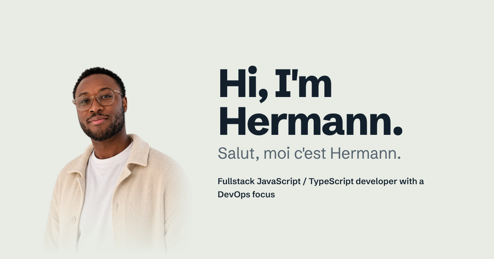

<!-- Généré depuis data/cv.yaml par scripts/build-readme.mjs. Ne pas modifier à la main : éditer cv.yaml puis lancer npm run build. -->

### Hi, I'm Hermann.

**Versatile developer, from product to infrastructure**, based in Saint-Étienne, France.

What defines me most is adaptability: I pick up whichever language, framework and layer a product needs. Day to day in TypeScript, on web and mobile, but equally at ease in Java, C#, Rust, Swift or Python depending on the context. I work from the product down to the infrastructure (CI/CD, Kubernetes, cloud, monitoring) and have often been a product's only engineer. Since 2025 I have been wiring AI agents into delivery pipelines, from the ticket to a tested pull request.

**Currently**

- Application integrator and DevOps engineer, B2B equipment financing company (financial group)
- Mobile developer, then fullstack developer, then software architect, The After Cancer, health support app (United States)

#### Experience

| When | Role | Where |
|---|---|---|
| Since Aug 2026 | Application integrator and DevOps engineer | B2B equipment financing company (financial group) |
| Jul 2025 – Sep 2026 | Fullstack developer | Versusmind, IT services company (Nancy) |
| Since Apr 2025 | Mobile developer, then fullstack developer, then software architect | The After Cancer, health support app (United States) |
| Jan 2023 – Dec 2024 | Freelance developer | Short assignments for studios and startups |
| Aug 2021 – Nov 2025 | Fullstack and DevOps developer | Nobo, home cleaning service (Palladium group) |
| Apr 2021 – Oct 2022 | System administrator | Snowtrust (Limoges) |
| Apr 2020 – Sep 2020 | Fullstack and DevOps intern | Nobo (Palladium group) |

#### Toolbox

- **Front-end, mobile and desktop**: TypeScript, React, Next.js, React Native, Expo, Flutter, SwiftUI, Rust / Tauri, TanStack Query, Redux Toolkit, Tailwind / NativeWind, Mantine UI
- **Back-end**: Node.js, NestJS, Express, PHP, Python, Java (Spring, Vaadin), .NET (ASP.NET Core), REST, GraphQL, OpenAPI, RabbitMQ, Pub/Sub, PostgreSQL, MySQL, Prisma, SQLite
- **CMS and e-commerce**: Sitecore XP / SXA, Payload CMS, WordPress, PrestaShop
- **DevOps and cloud**: Docker, Kubernetes (GKE, AKS), Argo CD, Ansible, Kamal, GitHub Actions, GitLab CI, Jenkins, Bitbucket Pipelines, Azure Pipelines, AWS, Azure, Google Cloud, OVH, OpenStack, Cloudflare, Traefik
- **Systems and monitoring**: Linux (Debian), Bash, OpenVPN, Tailscale, ELK, Loki / Grafana, Telegraf, Sentry, CloudWatch, OpenVAS
- **Testing and quality**: Playwright, Detox, Selenium, SonarQube
- **Applied AI**: Claude Code, AI agents, MCP, Ollama, LLM orchestration

#### Side projects

- **career-hub**: LLM-generated targeted resumes, rendered to PDF with Typst, with semantic search on pgvector.
- **Agent orchestration kanban**: Tauri desktop app to run several Claude Code sessions from a kanban board.
- **Éclore**: iOS app that helps people quit smoking and cannabis, designed to never shame the user.
- **[Appwrite Exceptions Translator](https://www.npmjs.com/package/@itishermann/appwrite-exceptions-translator)**: NPM package that turns Appwrite's technical error messages into clear, actionable explanations.
- **[10K Step Path Generator](https://10k-steps.itishermann.me)**: Loop walking-route generator for a daily step goal, with a Leaflet map, GPX export and local storage.
- **Sports Events**: Web platform for local sports events: creation, sign-up, geolocation and mapping.
- **Self-hosted AI infrastructure**: Local inference with Ollama on a GPU, routed over Tailscale, with services deployed through Dokploy behind Cloudflare Tunnel.

#### Education

- Master of Science, Software architect, application developer. ETNA, 2024
- Bachelor's degree, Web and mobile project manager. ETNA, 2022
- Engineering programme, Automated systems. ESSTI, 2019
- Preparatory classes, Mathematics, physics and mechanics. ESSTI, 2018

#### Interests

Hiking · Reading · Art · Photography · Car tuning · Electronics and home automation

#### Links

[Website](https://itishermann.me/en/) · [Blog](https://itishermann.hashnode.dev) · [LinkedIn](https://www.linkedin.com/in/itishermann) · [Resume (PDF)](https://itishermann.me/cv/hermann-kao-cv-en.pdf) · [CV in French (PDF)](https://itishermann.me/cv/hermann-kao-cv-fr.pdf) · [Contact](https://itishermann.me/en/#contact)

Version française

### Salut, moi c'est Hermann.

**Développeur polyvalent, du produit à l'infrastructure**, basé à Saint-Étienne, France.

Ce qui me caractérise le plus, c'est l'adaptation : je prends le langage, le framework et la couche dont le produit a besoin. Au quotidien en TypeScript, sur le web comme le mobile, mais aussi à l'aise en Java, C#, Rust, Swift ou Python selon le contexte. Je vais du produit à l'infrastructure (CI/CD, Kubernetes, cloud, supervision) et j'ai souvent été le seul technique d'un produit. Depuis 2025, j'intègre des agents IA dans les chaînes de livraison, du ticket jusqu'à la pull request testée.

**En ce moment**

- Intégrateur applicatif et DevOps, Société de financement d'équipements B2B (groupe financier)
- Développeur mobile, puis fullstack, puis architecte logiciel, The After Cancer, application d'accompagnement santé (États-Unis)

#### Parcours

| Quand | Poste | Où |
|---|---|---|
| Depuis août 2026 | Intégrateur applicatif et DevOps | Société de financement d'équipements B2B (groupe financier) |
| juil. 2025 – sept. 2026 | Développeur fullstack | Versusmind, ESN (Nancy) |
| Depuis avr. 2025 | Développeur mobile, puis fullstack, puis architecte logiciel | The After Cancer, application d'accompagnement santé (États-Unis) |
| janv. 2023 – déc. 2024 | Développeur freelance | Missions courtes pour des studios et startups |
| août 2021 – nov. 2025 | Développeur fullstack et DevOps | Nobo, service de ménage à domicile (groupe Palladium) |
| avr. 2021 – oct. 2022 | Administrateur système | Snowtrust (Limoges) |
| avr. 2020 – sept. 2020 | Stagiaire développeur fullstack et DevOps | Nobo (groupe Palladium) |

#### Outils

- **Front-end, mobile et desktop** : TypeScript, React, Next.js, React Native, Expo, Flutter, SwiftUI, Rust / Tauri, TanStack Query, Redux Toolkit, Tailwind / NativeWind, Mantine UI
- **Back-end** : Node.js, NestJS, Express, PHP, Python, Java (Spring, Vaadin), .NET (ASP.NET Core), REST, GraphQL, OpenAPI, RabbitMQ, Pub/Sub, PostgreSQL, MySQL, Prisma, SQLite
- **CMS et e-commerce** : Sitecore XP / SXA, Payload CMS, WordPress, PrestaShop
- **DevOps et cloud** : Docker, Kubernetes (GKE, AKS), Argo CD, Ansible, Kamal, GitHub Actions, GitLab CI, Jenkins, Bitbucket Pipelines, Azure Pipelines, AWS, Azure, Google Cloud, OVH, OpenStack, Cloudflare, Traefik
- **Systèmes et supervision** : Linux (Debian), Bash, OpenVPN, Tailscale, ELK, Loki / Grafana, Telegraf, Sentry, CloudWatch, OpenVAS
- **Tests et qualité** : Playwright, Detox, Selenium, SonarQube
- **IA appliquée** : Claude Code, AI agents, MCP, Ollama, LLM orchestration

#### Projets perso

- **career-hub** : Génération de CV ciblés par LLM, avec rendu PDF en Typst et recherche sémantique sur pgvector.
- **Kanban d'orchestration d'agents** : Application de bureau Tauri pour piloter plusieurs sessions Claude Code depuis un tableau kanban.
- **Éclore** : Application iOS d'aide à l'arrêt du tabac et du cannabis, conçue pour ne jamais culpabiliser.
- **[Appwrite Exceptions Translator](https://www.npmjs.com/package/@itishermann/appwrite-exceptions-translator)** : Package NPM qui traduit les messages d'erreur techniques d'Appwrite en explications claires et exploitables.
- **[10K Step Path Generator](https://10k-steps.itishermann.me)** : Générateur d'itinéraires de marche en boucle pour un objectif de pas quotidien, avec carte Leaflet, export GPX et stockage local.
- **Sports Events** : Plateforme web de gestion d'événements sportifs locaux : création, participation, géolocalisation et cartographie.
- **Infrastructure IA auto-hébergée** : Inférence locale avec Ollama sur GPU, routée via Tailscale, services déployés avec Dokploy derrière Cloudflare Tunnel.

#### Formation

- Master of Science, Architecte logiciel, développeur d'application. ETNA, 2024
- Bachelor, Responsable de projets web et mobile. ETNA, 2022
- Cycle ingénieur, Systèmes automatisés. ESSTI, 2019
- Classes préparatoires, Mathématiques, physique et mécanique. ESSTI, 2018

#### Centres d'intérêt

Randonnée · Lecture · Art · Photographie · Préparation automobile · Électronique et domotique

#### Liens

[Site](https://itishermann.me) · [Blog](https://itishermann.hashnode.dev) · [LinkedIn](https://www.linkedin.com/in/itishermann) · [CV (PDF)](https://itishermann.me/cv/hermann-kao-cv-fr.pdf) · [CV en anglais (PDF)](https://itishermann.me/cv/hermann-kao-cv-en.pdf) · [Contact](https://itishermann.me/#contact)

About this repository

This repository is the source of [itishermann.me](https://itishermann.me) and of my PDF resumes. Everything comes from [`data/cv.yaml`](data/cv.yaml): one build validates it against [`schema/cv.schema.json`](schema/cv.schema.json), renders the French and English PDFs with Typst, builds the static site with Astro, checks that every line of the PDFs can be read by an applicant tracking system, and regenerates this README. AI agents tailoring a resume follow [`AGENTS.md`](AGENTS.md).

